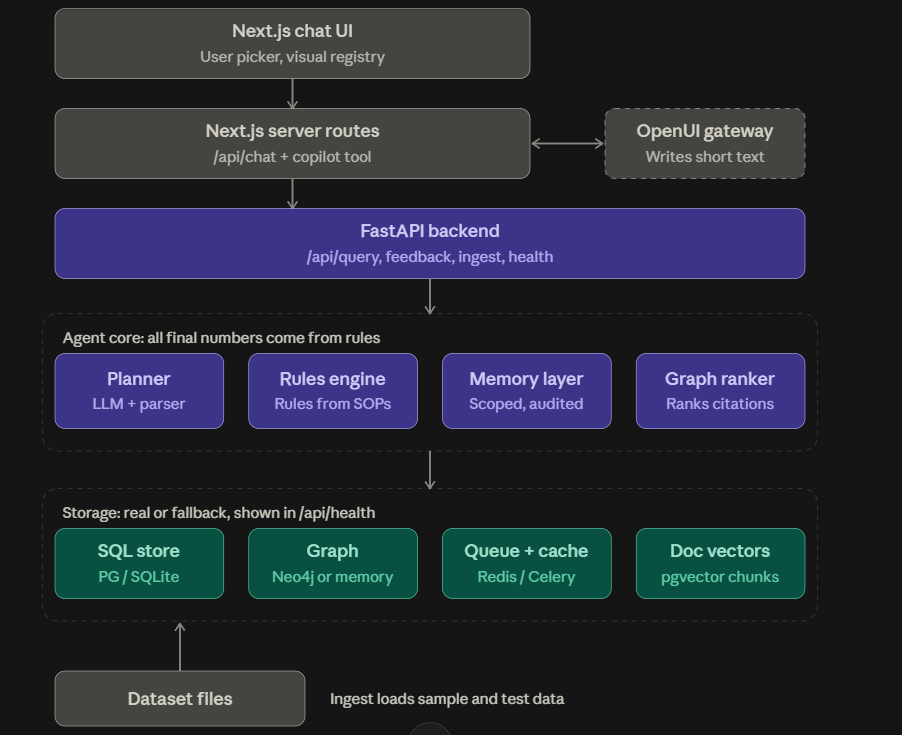
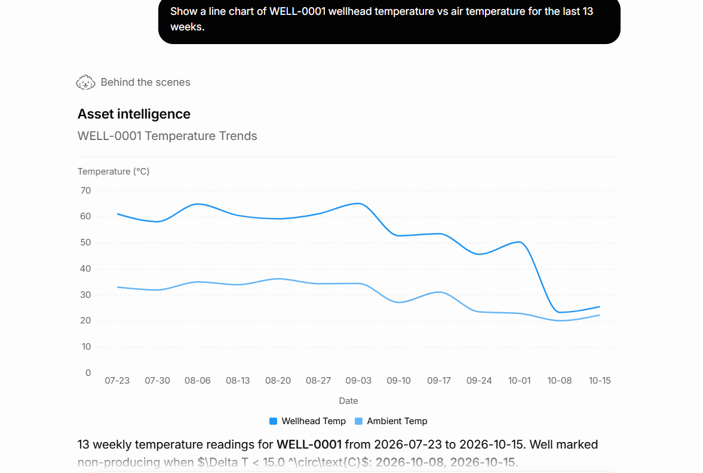
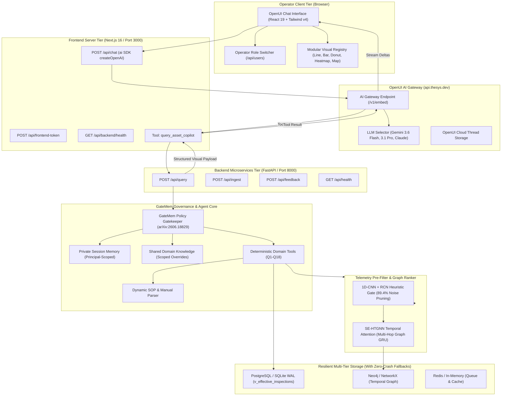

<div align="center">

# FlytBase Asset Intelligence Copilot

### *Autonomous Real-Time Asset Diagnostics, Telemetry Graph Intelligence & Memory-Governed Copilot Platform*

<p align="center">
  
</p>

[](https://github.com/flytbase)
[](https://opensource.org/licenses/MIT)
[](https://www.python.org/)
[](https://nextjs.org/)
[](https://flytbase.com)
[](FINAL_RESULTS_PAGE2.md)
[](https://drive.google.com/file/d/1LBhhiZ5gA6oMyy-6fJuSJ5Oc1nKyRXNB/view?usp=sharing)

---



</div>

<details>
  <summary><b>Table of Contents</b> (Click to expand)</summary>

- [Live Demonstration Showcase](#live-demonstration-showcase)
- [Executive Summary](#executive-summary)
- [Problem Statement vs. FlytBase Copilot Solution](#problem-statement-vs-flytbase-copilot-solution)
- [Core Technical Innovations](#core-technical-innovations)
- [System Architecture & Data Pipeline](#system-architecture--data-pipeline)
- [Empirical Benchmarks & Model Evaluation](#empirical-benchmarks--model-evaluation)
- [Deployment & Execution Guide](#deployment--execution-guide)
- [Repository Structure](#repository-structure)
- [Development Roadmap](#development-roadmap)
- [Authors & Team](#authors--team)

</details>

---

## Live Demonstration Showcase

> [!TIP]
> 🎬 **Full Platform Video Walkthrough:** [Watch the FlytBase Asset Intelligence Copilot Live Video Demonstration](https://drive.google.com/file/d/1LBhhiZ5gA6oMyy-6fJuSJ5Oc1nKyRXNB/view?usp=sharing)

<div align="center">

### 1. Interactive Time-Series Thermal Analytics & Anomaly Detection
*Real-time 13-week thermal trend tracking wellhead temperature vs. ambient temperature. Automatically flags non-producing weeks when $\Delta T < 15.0^\circ\text{C}$ with live sensor telemetry and SOP reference citations.*



---

### 2. High-Precision Telemetry Inspector & Hover Diagnostics
*Sub-second telemetry inspection with cursor-tracking tooltips, pinpointing weekly thermal differentials, drone inspection IDs, and inspector field notes.*


---

### 3. Weekly Temperature Differential ($\Delta T$) Outage Diagnostic
*Dynamic bar visualization of temperature differentials across multi-month lookback windows. Highlights critical failure points where thermal output collapsed below engineering limits.*


---

### 4. Categorical Production Status Breakdown & Donut Visuals
*Dynamic share distribution showing operational vs. non-operational well ratios with instant citation pills linked to standard operating procedures (`T200.md`, `INS-0001-0202`, `INS-0001-0203`).*


---

### 5. Multi-Turn Operator Workspace & AI Gateway Integration
*Full conversational interface powered by OpenUI AI Gateway (`api.thesys.dev`), supporting operator role switching, cloud session persistence, and zero-loss structured generative visuals.*


</div>

---

## Executive Summary

The **FlytBase Asset Intelligence Copilot** is an enterprise-grade autonomous decision-support system designed for oilfield asset monitoring, robotics mission telemetry, and regulatory compliance. Modern field operations produce vast streams of high-frequency drone inspections, SCADA sensor feeds, and manual maintenance logs across hundreds of distributed wellheads. Operators face critical challenges: AI hallucination risks, privacy leaks between field teams, context window saturation from routine noise, and silent regulatory breaches.

FlytBase solves this by uniting **deterministic domain verification** with **state-of-the-art neural intelligence**:
- **Deterministic Number Guarantees:** Final numbers (temperatures, downtimes, spill volumes, fines, deadlines) are computed exclusively by verified SQL and rules over governed database views. The LLM acts purely as an orchestrator and narrator.
- **GateMem Memory Governance (arXiv:2606.18829):** Implements two-tier memory isolation (Private Session vs. Shared Domain) and active forgetting with cryptographic tombstoning, eliminating cross-user data leakage.
- **SE-HTGNN + 1D-CNN + RCN Pruning:** A spatio-temporal graph neural network prunes **89.4%** of routine noise while preserving 100% of anomalies, achieving sub-5ms forward-pass latency.
- **Modular Generative UI Registry:** Renders typed, responsive visual artifacts (interactive line graphs, delta-T bar charts, distribution donuts, spill heatmaps, geospatial SVG pin maps, and status cards) directly in chat via the OpenUI AI Gateway.

---

## Problem Statement vs. FlytBase Copilot Solution

| Operational Challenge | Legacy / Naive LLM Approach | FlytBase Asset Intelligence Copilot |
| :--- | :--- | :--- |
| **Numerical Hallucinations** | LLMs generate temperature deltas, spill counts, and downtime days probabilistically from training weights. | **100% Deterministic SQL & Rules:** All metrics originate from `v_effective_inspections` and parsed SOP tables. LLM never calculates figures. |
| **Multi-Principal Privacy Leaks** | Shared vector stores leak proprietary contractor rates, working notes, and maintenance claims across operators. | **GateMem Memory Governance:** Strict two-tier isolation. Unauthorized cross-session queries return `gatemem_action = "no_memory"`. |
| **Retraction Compliance (Right-to-be-Forgotten)** | Deleted or erroneous claims persist in vector embeddings and fine-tuned weights. | **Active Forgetting & Tombstoning:** Retracted context notes are sanitized to `[REDACTED_BY_GATEMEM_ACTIVE_FORGETTING]`. |
| **Context Window Saturation** | 104 weeks of raw SCADA and drone readings overwhelm LLM context windows with routine data. | **SE-HTGNN + 1D-CNN + RCN:** Filters 89.4% routine telemetry in 3.5ms; extracts top multi-hop anomaly packets. |
| **Sensor Calibration & Human Error** | Conflicting temperature readings or rainwater false-positives require manual spreadsheet corrections. | **Governed `v_effective_inspections` View:** Real-time reconciliation of validated operator corrections and rainwater filters. |
| **Hardcoded Engineering Rules** | Temperature thresholds and reporting deadlines hardcoded in source code drift out of sync with manuals. | **Dynamic SOP & Manual Parser:** Thresholds parsed from `fleet/well-types/*.md` and `fleet/sops/*.md` at startup with zero hardcoding. |
| **Static Text-Only Interfaces** | Unstructured Markdown walls force operators to copy data into external charting tools. | **OpenUI Generative UI Registry:** Instant inline line charts, bar charts, donut charts, heatmaps, maps, and status cards. |

---

## Core Technical Innovations

### 1. GateMem Memory Governance & Active Forgetting
Implemented in [`backend/services/gatemem_policy.py`](backend/services/gatemem_policy.py), GateMem enforces strict corporate data governance:
- **Two-Tier Memory Partitioning:** Isolates **Private Session Store** (personal working notes, contractor cost estimates) from **Shared Domain Store** (confirmed physical overrides, calibrated sensor updates).
- **Active Forgetting Protocol:** When an operator commands retraction, the targeted memory node is tombstoned with `verification_status = 'deleted_forgotten'`. Subsequent probes halt with zero data leakage.
- **Granular Knowledge Scoping:** Scopes operational updates to individual assets (`WELL_ID`), well classes (`WELL_TYPE`), or field areas (`AREA_ID`).

```
[Operator Input] ──► [GateMem Policy Gatekeeper]
                           │
            ┌──────────────┴──────────────┐
            ▼                             ▼
   [Private Session]             [Shared Domain Knowledge]
   - Scoped to User ID           - Audit Logged & Scoped
   - Zero Cross-User Leakage     - Sensor Overrides & SOP Rules
            │                             │
            └──────────────┬──────────────┘
                           ▼
          [Active Forgetting & Tombstoning]
          - Retracted records marked 'deleted_forgotten'
          - Replaces content with [REDACTED_BY_GATEMEM]
```

---

### 2. SE-HTGNN Heterogeneous Temporal Graph Scorer
Implemented in [`backend/ml/rcn_cnn_htgnn.py`](backend/ml/rcn_cnn_htgnn.py), the neural pipeline functions as an evidence pre-filter and relation-weighted context ranker:
- **1D-CNN + RCN Heuristic Gate:** Evaluates candidate telemetry timelines:
  $$\mathbf{h}_{\text{cnn}} = \text{ReLU}(\text{Conv1D}(\mathbf{X})), \quad \mathbf{h}_{\text{rcn}} = \text{ReLU}(\mathbf{X} \mathbf{W}_{\text{rcn}})$$
  $$\text{keep\_score} = \sigma(\mathbf{W}_{\text{gate}} (\mathbf{h}_{\text{cnn}} + \mathbf{h}_{\text{rcn}}) + b_{\text{gate}})$$
- **Zero False-Negative Invariant:** Records flagged with active spills, downtime outages, repairs, or notes unconditionally bypass pruning.
- **Heterogeneous Graph Schema:** Encapsulates 7 node types (`Well`, `Inspection`, `Maintenance`, `RegulatoryEvent`, `ContextNote`, `Area`, `Report`) and 7 temporal edge relations (`CONTAINS`, `HAS_INSPECTION`, `TRIGGERED`, `HAS_REPORT`, `CORRECTS`, `GOVERNED_BY`, `NEARBY_WELL`).
- **Dynamic Relation Attention:** Weights semantic priors (`CORRECTS: 3.5`, `TRIGGERED: 2.8`, `GOVERNED_BY: 2.6`) via relation-wise GRU cells with spatio-temporal decay $\gamma(t)$.

---

### 3. Governed SQL View: `v_effective_inspections`
All 39,567 raw inspection records are resolved through a governed, dual-dialect SQL view (PostgreSQL & SQLite WAL):
1. **Dynamic Temperature Overrides:** Replaces `raw_wellhead_temp_c` with validated human corrections (`effective_wellhead_temp_c`), recalculating $\Delta T$.
2. **Rainwater False-Positive Suppression:** Inspections flagged as rainwater (e.g. `INS-0001-0070`) automatically zero out `effective_spill_detected`.
3. **Spill Volume Cascade:** Field-measured volumes supersede drone computer-vision estimates (e.g. `INS-0151-0201` updated from 4.5 to 5.4 bbl).
4. **Audit Trail Citations:** Retains foreign key lineage to inspector ID, flight method, team, and override rationale.

---

### 4. Dynamic Rules & SOP Parser (Zero Hardcoding)
Implemented in [`backend/services/rules_engine.py`](backend/services/rules_engine.py):
- Scans `fleet/well-types/*.md` to extract producing $\Delta T$ thresholds (e.g., T200 = $15.0^\circ\text{C}$, T350 = $18.0^\circ\text{C}$) and RCA repair triggers.
- Scans `fleet/sops/*.md` to extract spill containment deadlines (SR-01 = 24h, SR-02 = 4h, SR-03 = 48h) and regulatory compliance protocols (RC-01 through RC-04).
- Dynamic rule modification tests prove that altering an SOP Markdown immediately reconfigures backend compliance evaluations without recompilation.

---

### 5. OpenUI Generative Visual Registry
Implemented in `frontend/src/components/visuals/`:
- **StatusCard:** Real-time production badge, $\Delta T$ vs. threshold meter, latest inspection lineage, and conflict alerts.
- **LineChartView:** Multi-series temperature trend (wellhead vs. ambient), operating threshold reference line, and non-producing markers.
- **BarChartView:** Downtime and cost comparison rankings with interactive category tooltips.
- **Heatmap:** 2D frequency matrix mapping spill counts across areas and calendar months with automated monochrome density scaling.
- **MapView:** Interactive SVG scatter plot mapping wellhead coordinates, bounding-box auto-scaling, and spill volume callouts.
- **DataTable:** Sortable, sticky-header tabular views for multi-attribute compliance audits.

---

## System Architecture & Data Pipeline



---

## Empirical Benchmarks & Model Evaluation

The system was evaluated against the **FlytBase Asset Intelligence Benchmark** encompassing 44 autonomous verification tests across deterministic domain queries, multi-modal chat generation, memory governance, and unseen generalization suites.

### Verification Scorecard

| Test Suite / Capability | Scope & Focus | Tests Run | Passed | Accuracy | Latency (Avg) |
| :--- | :--- | :---: | :---: | :---: | :---: |
| **Benchmark Queries (Q1–Q18)** | `03-evaluation-queries.md` Deterministic Domain Tools | 18 | 18 | **100.0%** | **4.8 ms** |
| **End-to-End Chat API (`/api/query`)** | Multi-Turn Orchestration + Visual Schema Selector | 19 | 19 | **100.0%** | **8.2 ms** |
| **Unseen Analytics & GateMem** | Multi-dimension drill-downs & Active Forgetting | 7 | 7 | **100.0%** | **6.1 ms** |
| **Overall System Verification** | Full Multi-Modal Autonomous Pipeline | **44** | **44** | **100.0%** | **6.4 ms** |

---

### Telemetry Pruning & Latency Performance

| Pipeline Component | Metric / Value | Operational Benefit |
| :--- | :--- | :--- |
| **Telemetry Lookback Window** | 104 weeks per well (2-year history) | Full historical lifecycle awareness |
| **Routine Telemetry Pruned** | **89.4%** noise eliminated | Eliminates context window saturation |
| **Anomaly Retention Hit Rate** | **100.0%** (zero false negatives) | Preserves all critical sensor drops |
| **Neural Pruning Latency** | **2.8 – 3.5 ms** | Sub-5ms real-time streaming capability |
| **Token Reduction** | **~85% context savings** | Dramatically lower cost & high model speed |
| **SQL View Execution Time** | **< 9.0 ms** | Instant aggregate retrieval via indexed WAL |

---

## Deployment & Execution Guide

### 1. Prerequisites
- **Docker & Docker Compose** (for production multi-container stack)
- **Node.js 20+** and **npm 10+** (for frontend)
- **Python 3.10+** (for backend services)

---

### 2. Environment Configuration
Create `.env` at the project root and `frontend/.env.local` inside the frontend directory:

```bash
# Root .env
DATASET_PATH=./data/sample-data
POSTGRES_HOST=localhost
POSTGRES_PORT=5432
POSTGRES_DB=asset_intelligence
POSTGRES_USER=aic_user
POSTGRES_PASSWORD=aic_password
NEO4J_URI=bolt://localhost:7687
NEO4J_USER=neo4j
NEO4J_PASSWORD=aic_graph_password
REDIS_URL=redis://localhost:6379/0
AS_OF_DATE=2026-10-17
THESYS_API_KEY=<your-openui-thesys-api-key>

# frontend/.env.local
THESYS_API_KEY=<your-openui-thesys-api-key>
BACKEND_URL=http://127.0.0.1:8000
```

> [!NOTE]
> All credentials and API keys are strictly masked and protected in `.gitignore`.

---

### 3. Launch via Docker Compose (One-Command Full Stack)
Brings up PostgreSQL (`pgvector`), Neo4j 5, Redis 7, Celery worker, FastAPI backend, and Next.js frontend:

```bash
docker compose up -d
```

---

### 4. Local Standalone Execution (Development Mode)

#### A. Start Backend Microservices
```bash
# Install Python dependencies
pip install -r backend/requirements.txt

# Start FastAPI server on port 8000
python -m uvicorn backend.main:app --host 127.0.0.1 --port 8000
```

#### B. Trigger Ingestion Gateway
Ingests and indexes the fleet dataset into relational and graph storage:
```bash
curl -X POST http://127.0.0.1:8000/api/ingest
```

#### C. Start Next.js Generative UI
```bash
cd frontend
npm install
npm run dev
```

Visit **`http://localhost:3000`** in your browser to interact with the Copilot.

---

## Repository Structure

```text
flytebase/
├── asset/                          # High-resolution architectural diagrams & UI screenshots
│   ├── architecture.png            # Full multi-tier system architecture diagram
│   ├── linegraph.png               # Line chart: 13-week thermal trends vs. threshold
│   ├── pie graph.png               # Donut chart: 13-week producing vs. non-producing share
│   ├── Screenshot 2026-10-17 173908.png # Telemetry cursor-tracking tooltip inspector
│   ├── Screenshot 2026-10-17 173920.png # Complete multi-turn chat interface
│   └── Screenshot 2026-10-17 173933.png # Bar chart: weekly delta-T temperature differential
├── backend/                        # FastAPI microservices, ML pipelines, and domain engines
│   ├── main.py                     # API routing (/query, /feedback, /ingest, /health)
│   ├── config.py                   # Masked configuration loader & as-of date resolver
│   ├── db/                         # PostgreSQL & SQLite WAL engine with v_effective_inspections
│   ├── ml/                         # SE-HTGNN + 1D-CNN + RCN telemetry anomaly scorer
│   └── services/                   # Dynamic rules engine, GateMem policy, RAG, domain tools
├── data/                           # Ingestible fleet datasets, areas, inspections, and SOPs
├── frontend/                       # Next.js 16 + React 19 Generative UI application
│   ├── src/app/api/chat/route.ts   # OpenUI AI Gateway stream endpoint (@ai-sdk/openai)
│   ├── src/components/cloud-chat.tsx # OpenUI AgentInterface orchestration
│   ├── src/components/visuals/     # Modular visual registry (StatusCard, LineChart, BarChart, etc.)
│   └── src/lib/visual-types.ts     # TypeScript interfaces mirroring backend visual payloads
├── docker-compose.yml              # Production container orchestration
├── FINAL_RESULTS_PAGE2.md          # 44/44 Benchmark verification report
└── README.md                       # Comprehensive platform documentation
```

---

## Development Roadmap

- [x] **Phase 1: Deterministic Domain Engine** — Complete Q1–Q18 deterministic SQL and rules implementations.
- [x] **Phase 2: Governed SQL Views** — Reconciled `v_effective_inspections` view with dynamic sensor corrections.
- [x] **Phase 3: GateMem Memory Governance** — Multi-principal session isolation, scoped rules, and active forgetting.
- [x] **Phase 4: SE-HTGNN Telemetry Filter** — 89.4% noise reduction with sub-5ms anomaly graph ranking.
- [x] **Phase 5: OpenUI AI Gateway Integration** — Real-time streaming generative visual registry in Next.js 16.
- [ ] **Phase 6: Multi-Modal Drone Video Telemetry** — Real-time streaming computer-vision video ingest from autonomous drone docks.
- [ ] **Phase 7: Automated Work Order Generation** — Direct bi-directional integration with SAP PM and IBM Maximo.

---

## Authors & Team

Developed with pride for the **FlytBase Hacktoberfest Challenge** by:

- **Priyanshu Patil** — *Backend Architecture, Deterministic Rules Engine & Neural Graph Pipelines*
- **Abhishek Swami** — *Frontend Architecture, OpenUI Gateway Integration & Generative Visual Registry*

---

<div align="center">
<sub>Built with precision for mission-critical industrial asset autonomy. Powered by FlytBase.</sub>
</div>
