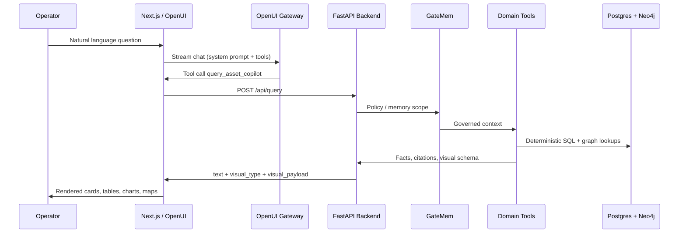

# FlytBase Asset Intelligence Copilot — System Documentation

**Version:** 2.0.0 · **Evaluation reference date:** 16 October 2026 · **Repository:** `flytebase` (backend + frontend monorepo)

---

## Page 1 — System Design

### 1.1 Purpose

The Asset Intelligence Copilot answers natural-language questions about upstream oil & gas field assets (200 wells across four operating areas). Answers combine **deterministic domain logic** (SQL views, SOP rules, downtime math) with **governed memory** (GateMem), **graph/RAG retrieval**, and a **neural telemetry scorer** (RCN + 1D-CNN + HTGNN). The LLM orchestrates conversation and UI; it does **not** invent operational numbers.

### 1.2 High-Level Architecture

```text
┌─────────────────────────────────────────────────────────────────────────────┐
│                         OPERATOR (Web Browser)                               │
└───────────────────────────────────┬─────────────────────────────────────────┘
                                    │ HTTPS
                                    ▼
┌─────────────────────────────────────────────────────────────────────────────┐
│  FRONTEND — Next.js 16 + OpenUI Agent Interface (React 19, Tailwind v4)   │
│  • Model switcher (Gateway-backed models)                                    │
│  • Streaming generative UI (OpenUI Lang → Renderer)                          │
│  • Routes: /api/chat, /api/backend/* (health, users, feedback proxies)       │
└───────────────┬─────────────────────────────┬───────────────────────────────┘
                │ THESYS_API_KEY (server)       │ BACKEND_URL
                ▼                               ▼
┌───────────────────────────────┐   ┌─────────────────────────────────────────┐
│ OpenUI AI Gateway             │   │ BACKEND — FastAPI (uvicorn :8000)        │
│ https://api.thesys.dev/v1/    │   │ POST /api/query  ·  POST /api/ingest     │
│ embed — streaming + autofix   │   │ GET  /api/health ·  POST /api/feedback   │
└───────────────────────────────┘   └───────────────────┬─────────────────────┘
                                                      │
                    ┌─────────────────────────────────┼─────────────────────────┐
                    │         REQUEST PIPELINE (per query)                        │
                    ▼                                 ▼                         ▼
         ┌──────────────────┐              ┌──────────────────────┐    ┌─────────────────┐
         │ GateMem Policy   │              │ Rules Engine +       │    │ Copilot Agent   │
         │ Session isolation│──────────────│ Domain Tools         │───▶│ RAG + visuals   │
         │ Overrides/forget │              │ SOP/RCA/downtime     │    │ OpenUI payload  │
         └──────────────────┘              └──────────┬───────────┘    └─────────────────┘
                                                      │
                    ┌─────────────────────────────────┼─────────────────────────┐
                    ▼                                 ▼                         ▼
         ┌──────────────────┐              ┌──────────────────────┐    ┌─────────────────┐
         │ RCN+CNN+HTGNN    │              │ PostgreSQL (pgvector)│    │ Neo4j 5         │
         │ Telemetry rank   │              │ Wells, inspections,  │    │ Spatio-temporal │
         │ & anomaly hints  │              │ v_effective_inspect. │    │ entity graph    │
         └──────────────────┘              └──────────────────────┘    └─────────────────┘
                                                      │
                    ┌─────────────────────────────────┴─────────────────────────┐
                    ▼                                                           ▼
         ┌──────────────────┐                                        ┌─────────────────┐
         │ Redis            │                                        │ Celery Worker   │
         │ Cache + broker   │◀───────────────────────────────────────│ Async ingest    │
         └──────────────────┘                                        └─────────────────┘
```

### 1.3 Query Flow (Sequence)



### 1.4 Design Principles

| Principle | Implementation |
|-----------|----------------|
| **Numbers from data, not models** | Downtime, spills, breaches, and status come from SQL views and `rules_engine` parsing fleet markdown SOPs. |
| **Inspection overrides stale records** | Latest thermal ΔT supersedes `wells.recorded_status`; corrections live in `context_notes` via `v_effective_inspections`. |
| **Memory governance** | GateMem enforces per-user private sessions, fleet-wide shared corrections, active forgetting, and conflict surfacing. |
| **Separation of concerns** | Frontend has no Python; backend has no UI framework. Integration is REST + structured visual payloads. |

---

<div style="page-break-after: always;"></div>

## Page 2 — Components, Data & Operations

### 2.1 Major Components

| Layer | Path / Service | Responsibility |
|-------|----------------|----------------|
| **UI** | `frontend/` | Chat, model picker, map/heatmap/chart views, backend health sidebar. |
| **Chat bridge** | `frontend/src/app/api/chat/route.ts` | Gateway client, tool `query_asset_copilot`, OpenUI system prompt. |
| **API** | `backend/main.py` | Health, ingest, query, feedback, user listing. |
| **Governance** | `backend/services/gatemem_policy.py` | Session scope, propagation, forget, cross-user blocks. |
| **Rules** | `backend/services/rules_engine.py` | T200/T350 ΔT thresholds, SR-01–03, RC-04, WS-03 from markdown. |
| **Domain** | `backend/services/domain_tools.py` | Well status, offline lists, spills, downtime, SOP audit, RCA. |
| **Agent** | `backend/services/copilot_agent.py` | Answer assembly, RAG, visual schema selection. |
| **ML** | `backend/ml/rcn_cnn_htgnn.py` | Telemetry packet scoring (latency ~4 ms). |
| **Ingest** | `backend/ingest/`, Celery | JSONL/CSV load into Postgres; Neo4j sync; optional async via Redis. |

### 2.2 Data Stores

| Store | Role | Key artifacts |
|-------|------|----------------|
| **PostgreSQL + pgvector** | System of record | `wells`, inspections, maintenance, regulatory events, `context_notes`, embeddings. |
| **Neo4j** | Relationship & temporal graph | Well–area–event links for graph-augmented retrieval. |
| **Redis** | Cache + Celery broker/result | Hot query cache; background ingest jobs. |
| **Sample dataset** | Ingest source | `flytbase-ahc-swe-asset-intelligence-dataset/sample-data` (200 wells, ~40k inspections). |

### 2.3 API Surface (Backend)

| Method | Path | Purpose |
|--------|------|---------|
| `GET` | `/api/health` | Postgres, Neo4j, cache, vector store status; wells loaded; `as_of_date`. |
| `POST` | `/api/ingest` | Load dataset (sync or `async_mode` → Celery). |
| `POST` | `/api/query` | Primary copilot: `{ "query", "user_id", "session_id" }` → text + visuals. |
| `POST` | `/api/feedback` | Operator corrections (temperature, spill volume, scoped rules). |

Frontend proxies health/users/feedback under `/api/backend/*` using `BACKEND_URL` (never exposed API keys to the browser).

### 2.4 Visual Response Types (OpenUI)

Backend returns `visual_type` and `visual_payload` for the renderer: `status_card`, `table`, `line_chart`, `bar_chart`, `map`, `heatmap`, and plain `text`. The gateway streams OpenUI Lang; tool results inject structured metrics from the backend.

### 2.5 Deployment & Local Run

**Docker (full stack):** from repo root, `docker compose up -d` starts Postgres, Neo4j, Redis, FastAPI backend, Celery worker, and Next.js frontend (ports **5432**, **7474/7687**, **6379**, **8000**, **3000**).

**Development:** `docker compose up -d` for data services; `python -m backend.main` and `cd frontend && npm run dev`. Set `THESYS_API_KEY`, `OPENAI_API_KEY` / `GEMINI_API_KEY` as needed in server-side env only.

**Environment highlights:** `AS_OF_DATE` (benchmark “today”), `POSTGRES_DSN`, `NEO4J_URI`, `REDIS_URL`, `SAMPLE_DATA_PATH`.

### 2.6 Verification

| Suite | Coverage |
|-------|----------|
| `backend/verify_18_queries.py` | Benchmark scenarios Q1–Q18 (domain ground truth). |
| `backend/test_chat_e2e.py` | End-to-end `/api/query` and payload shapes. |
| `backend/test_unseen_generalization.py` | Unseen wells/areas, GateMem forgetting. |
| `backend/run_final_showdown.py` | Full pipeline regression (44 checks). |

### 2.7 Generalization to Unseen Evaluation

Three invariants support held-out wells (`WELL-0201+`), new areas, and shifted dates without code changes: (1) **document-driven rules** from `fleet/` markdown at startup; (2) **dynamic area and asset ID resolution** from `fleet/areas.json` and regex; (3) **`v_effective_inspections`** as the single governed view for all numeric answers.

---

*For branch workflow see `docs/BRANCHING.md`. For frontend–backend wiring see `frontend/docs/BACKEND-INTEGRATION.md`.*
